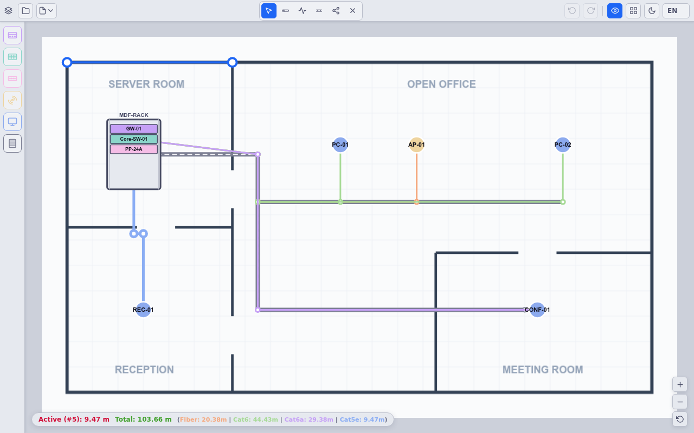
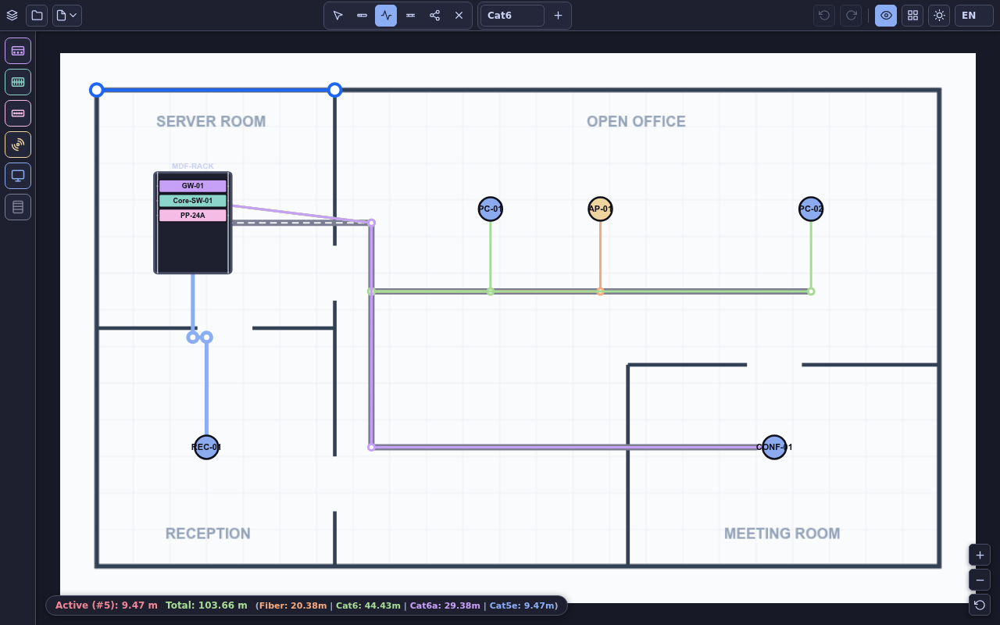
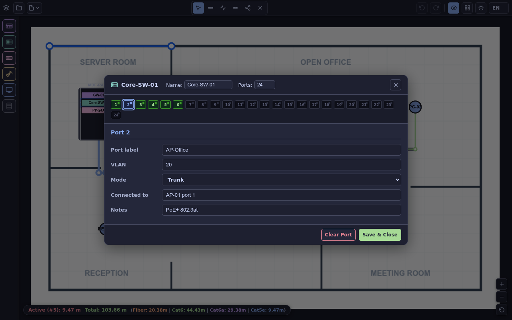

# Measurer App

A lightweight, client-side web application to place network devices, route cables and wire-ways, and measure cable runs directly on floorplans.

---

## Screenshots

### Light Theme & Floorplan Overview


### Dark Theme & Cable Routing


### Switch Port Configuration


---

## Features

- **Floorplan Support**: Load standard raster images (PNG, JPEG, WebP, GIF, BMP) or single-page PDF floorplans via file picker or drag-and-drop.
- **Calibration & Scaling (Optional)**: Calibrate the canvas by placing two points along a known wall or doorway and entering its real-world distance in meters.
- **Cable Estimation & Types**: Draw multiple independent cable runs with real-time length aggregation by type (**Cat5e**, **Cat6**, **Cat6a**, **Fiber**, **Power**, **Default**).
- **Wire-way Routing**: Draft structural pathways and conduits with point dragging, segment insertion, and deletion.
- **Smart Port Connections**: Link specific ports between two devices in **Connect** mode with optional intermediate bend points; deleting a smart cable or device automatically frees the linked ports.
- **Unified Select & Move Mode**: Drag devices, bend points, and wire-way nodes, pull new bend points directly from cable/wire-way segments, resize **Rack Cabinets** from any edge or corner, marquee-select (`Shift`/`Ctrl` click supported) for batch move/delete, or click a device to configure its ports.
- **Intelligent Rack Layering**: Non-rack devices placed on a **Rack Cabinet** automatically stack inside it and render on top for clean selection and routing.
- **Device Placement & Port Configuration**: Place **Router (RT)**, **Switch (SW)**, **Patch Panel (PP)**, **Access Point (AP)**, **Client PC (PC)**, and **Rack Cabinet (RACK)** components, and configure 1–128 ports per device (Label, VLAN, Access/Trunk/Uplink mode, Connection, Notes).
- **Snap to Grid & Layer Visibility**: Toggle a viewport-optimized 20px grid (`Alt` + drag or `Shift` + drag on empty canvas to offset) and toggle layer visibility.
- **Crisp HiDPI / Retina Rendering & Vector Icons**: High-DPI canvas scaling (`devicePixelRatio`), unified SVG vector icons, and Catppuccin Light/Dark themes.
- **Internationalization (i18n)**: Full English and Hungarian interface (`EN` / `HU`).
- **Workspace Backup, Export & Privacy Controls**:
  - Save and reload `.plan` workspace files.
  - Export the annotated floorplan as PDF (with PNG fallback).
  - Toggle **Auto-save** (`localStorage`) on/off at any time, or clear all stored browser data in one click with **Wipe Saved**.
  - 100% client-side and offline-ready with strict Content Security Policy and self-hosted vendor libraries.
- **Full Undo / Redo**: Supports `Ctrl+Z` / `Ctrl+Y` across placement, moves, rack resizing, edits, smart connections, and deletions.
- **Mobile & Touch Optimization**: Two-finger pinch-to-zoom/pan and vertical finger offset while dragging points.

---

## How to Run

Serve the repository from any static HTTP server (or host it on GitHub Pages):

```bash
python3 -m http.server 8000
```

Then open `http://localhost:8000` in your browser.

> **Note:** Opening `index.html` directly via `file://` works for image floorplans, `.plan` files, and PDF exports, but PDF floorplan import requires HTTP due to browser ES-module restrictions.

---

## How to Use

1. **Open**: Click **Open** (`O`) or drag and drop an image, PDF floorplan, or `.plan` file.
2. **Calibrate**: Click **Scale** (`S`), place two points on a known wall, adjust if needed, and click **Confirm** to enter the length in meters.
3. **Draft Cables & Wire-ways**:
   - Click **Cables** (`M`), choose a cable type from the contextual selector, and trace paths. Press `Enter`, double-click, or click **New** (`N`) to start another cable.
   - Click **Wire-way** (`W`) to draw conduit paths and press `Enter`, double-click, or click **New** (`Q`) for a new segment.
4. **Place & Link Devices**:
   - Click a device in the left sidebar and click on the floorplan to place it.
   - Click any placed device in **Select** mode to rename it and configure its ports.
   - Use **Connect** (`C`) to link a port on Device A through optional bend points to a port on Device B.
5. **Manage & Refine**:
   - **Select** (`V` / `D`) is the default mode: click devices to configure ports, drag devices/points to move them, drag any cable/wire-way segment to pull out a new bend point, drag rack edges/corners to resize racks, or drag empty space for marquee multi-select.
   - **Right-Click** on a device or point to rename or delete it.
6. **File, Export & Storage**:
   - Open the **File** menu to **Save .plan**, **Export PDF**, toggle **Auto-save**, **Clear All**, or **Wipe Saved** browser data.

> **Navigation Controls:**
> - **Desktop**: Mouse wheel to zoom; **Space + drag**, **Right-Click drag**, **Middle-Click drag**, or **Ctrl + drag** to pan; **Alt + drag** (or **Shift + drag** on empty canvas) to offset the grid when Grid is active.
> - **Mobile**: Two-finger pinch to zoom and pan.

---

## Keyboard Shortcuts

| Shortcut | Action | Description |
| :--- | :--- | :--- |
| `O` / `Alt + O` | Open File | Opens the file picker to load an image, PDF, or `.plan` file |
| `Ctrl + Z` | Undo | Undoes the last action |
| `Ctrl + Y` | Redo | Re-applies an undone action |
| `F2` | Rename | Renames the selected or right-clicked device |
| `Delete` / `Backspace` | Delete | Removes the selected devices, last Connect bend point, or hovered delete target |
| `Escape` | Return to Select | Closes dialogs, cancels active placement/tool, and returns to Select mode |
| `Space + Drag` | Pan Canvas | Pans the floorplan while holding Space |
| `Enter` / Double-Click | Finish Path | Finishes the current cable or wire-way run and starts a new one |
| `V` / `D` | Select Tool | Activates unified select, move, bend-insert, and rack resize mode |
| `S` | Scale Tool | Activates calibration mode |
| `M` | Cables Tool | Activates cable drawing mode |
| `N` | New Cable | Starts a new cable run |
| `W` | Wire-way Tool | Activates wire-way drawing mode |
| `Q` | New Wire-way | Starts a new wire-way path |
| `C` | Connect Tool | Activates port-to-port smart connection mode |
| `E` | Delete Tool | Toggles single-element delete mode |

---

made by : kicsirigo
